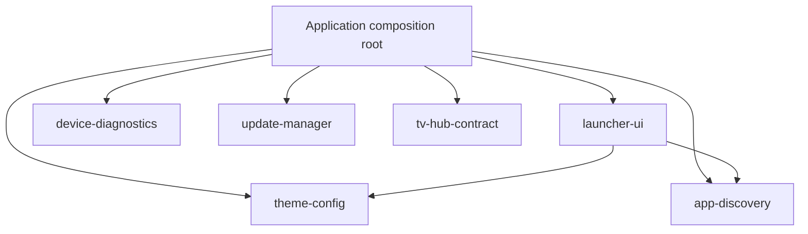

# Application architecture

The application uses native Kotlin and Android Views. Each of the six libraries builds as its own Android AAR with minimum API29, compile SDK35 and JVM17. The development app is `app.swtv.home`, version 0.3.0/code 3, targeting SDK35. Toolchain versions remain pinned.

| Module / namespace | Responsibility | Project dependencies |
| --- | --- | --- |
| `app` / `app.swtv.home` | Sole application/Activity, lifecycle, foreground observers, persistence callbacks, worker composition and service actions | All six libraries |
| `launcher-ui` / `app.swtv.launcher.ui`, `.runtime` | Complete reusable HomeScreen renderer, remote focus, settings, bounded icons/wallpaper/weather workers | theme-config, app-discovery |
| `theme-config` / `app.swtv.theme` | LauncherConfig, ModuleTile, JSON codec/preferences, theme and motion policy | None |
| `app-discovery` / `app.swtv.discovery` | AppEntry/catalog, package launch discovery, dock/picker rules, TV inputs and typed input intents | None |
| `device-diagnostics` / `app.swtv.diagnostics` | On-demand read-only snapshot, missing-value handling and formatting | None |
| `update-manager` / `app.swtv.updates` | Build identity, strict manifest and origin policy, cancellable HTTPS transport, streamed verification and private staging | None |
| `tv-hub-contract` / `app.swtv.tvhub.contract` | Versioned navigation request, strict compatibility/handler policy and explicit launch client | None |

Libraries cannot depend on the application or import its MainActivity, R or BuildConfig. `scripts/verify-module-boundaries.py` guards the graph, namespaces, API/JVM settings, unique model ownership and renderer placement. App-only service actions enter the renderer through callbacks; LauncherHost exposes the Activity context, current catalog/configuration and save/notice/wallpaper actions. No library casts that host back to MainActivity.

## Runtime and state

MainActivity owns foreground catalog refresh, package/time observation, theme scheduling and worker lifecycle. HomeScreen owns layout, toolbar, clock/weather, watch shortcuts, custom modules, app dock/grid, dialogs and focus restoration. Configuration remains app-local: preference file `home`, key `config`, JSON schema1. The legacy fixture covers all persisted fields; weather retains file `weather-cache`, schema2 and its existing keys.

Icon work is bounded to one running and48 queued requests with a48-entry finished cache and generation-safe weak view bindings. Wallpaper decoding is sampled off main, coalesces the same URI and admits one running plus one latest pending request. Weather is opt-in, uses a manually entered place, coalesces per-city work and enforces cooldown/cache identity. No location permission or persistent service exists. Pause cancels foreground work; destruction closes workers.

Dock display/editing share one effective sequence. Catalog selections retain stable package/input IDs across refresh. Persisted pins survive transient package gaps; explicit user edits reconcile the current sequence. D-pad focus remains attached to stable control keys. The stock launcher and Settings recovery routes remain available.

## External handoffs

OwnTV remains a separate ordinary application shortcut, default `tv.own.owntv`, with a configurable package target and explicit GitHub-releases browser option when absent. No player code, APK download or installer is included.

TV Hub uses the separate [navigation contract](TV_HUB_INTERFACE.md). Only an enabled, exported, uniquely matching handler in `app.swtv.tvhub` with integer major-version metadata1 is eligible. The outgoing intent names the resolved component and expected package. Missing, incompatible and unavailable states are visible; an ordinary package launch never bypasses the contract. Package identity alone is not publisher authentication; the navigation request carries no credentials or media data.

TV input shortcuts revalidate the current passthrough source and connected/standby status, then delegate through an explicit channel MIME and passthrough URI. Tuner/software sources stay with OEM TV software. Starting an Activity does not prove physical HDMI switching succeeded.

## Diagnostic and update boundaries

Diagnostics run only after an explicit user action. They report public Build fields/ABIs/API, display dimensions/density, OS memory, the current process's memory and the filesystem backing this app's data directory. Unavailable values are labeled; free filesystem space is not advertised as total physical flash. No device identifiers, accounts, private-file inspection, ADB commands or system-setting writes are included.

The update library retains its typed unconfigured provider and adds a release engine. A configured feed is restricted to one launcher GitHub repository. The manifest is capped at 64 KiB and the APK at 32 MiB. Parsing uses the canonical flat ASCII schema emitted by the release script, rejects duplicate or unknown members, and validates exact field types. Downloads stream to a dedicated app-private temporary directory. The engine checks the current and candidate package, increasing version code, supported SDK, expected single certificate fingerprint, byte count and SHA-256. A verified file remains bound to its originating engine and is rechecked before installer handoff.

The HTTPS transport uses pinned OkHttp 4.12.0 with explicit cookie and authentication isolation, manual origin-checked redirects, an active call deadline and cancellation. Okio 3.6.0 is transitive. These are ordinary runtime dependencies inside update-manager. The module graph stays acyclic and library APIs use platform-independent values.

The application reads feed and public certificate configuration from its own release manifest. Debug and unconfigured builds report that state in About. The app owns Android package metadata inspection and one foreground update panel. Check, download, source-permission Settings and install are separate user actions. A bounded worker stages the verified APK into a PackageInstaller session. A non-exported release receiver accepts results tied to the current session and nonce. Android presents installation confirmation and verifies the APK signature. Session and temporary-file cleanup follow cancellation, failure and process restart.

GitHub Actions produces unsigned, revision-recorded build input. The local release script checks the input hash, actual manifest configuration and permissions, then aligns, signs, verifies and creates a complete local bundle. The production key is managed offline by the owner. See `RELEASE_SIGNING.md` for the release and recovery procedure. The future TV Hub has its own version and feed. M3U, XMLTV, channel matching, Media3, media caching and favorites remain reserved for that application.
